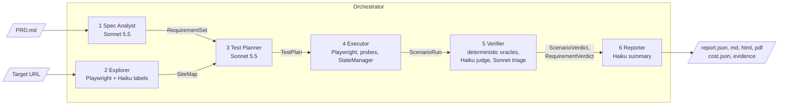

# qa-agent: spec-driven multi-agent QA for web apps

`qa-agent` reads a PRD and a target URL. It extracts testable requirements, explores the live site,
plans positive, negative and edge-case scenarios, and runs them in a real Chromium browser. It then
reports every requirement as **passed**, **failed** or **unverified**, with screenshots, network logs, console errors,
expected and observed values, reproduction steps, and the API cost of the run. Six cooperating agents
use Claude Sonnet 5.5 and Haiku 4.5, but **deterministic oracles decide every verdict**. The LLMs plan,
label and triage. They never mark anything as passed.

**Headline results.** Sample run `qa-20261018-1628-861e`, committed under [`runs/sample/`](runs/sample/),
run against the local DemoBank target. It was recorded just before two small additions: console-error
evidence and the optional `--repo` input. Both are covered by tests and were checked live without LLM calls.

| Metric | Result |
|---|---|
| Requirements extracted / scenarios run | 49 / 59 (26 positive, 17 negative, 16 edge) |
| Passed / failed / unverified | **27 / 11 / 11** (78% of requirements verified) |
| Defects reported | **8** (3 critical, 5 major), each with evidence and repro steps. They trace back to 4 underlying bugs, each reported against every requirement it breaks |
| Accuracy vs. hand-verified answer key (6 entries) | defect recall **4/4**, precision on labeled failures **100%**, **0** false passes, **0** false fails |
| LLM cost of this run | **$0.10** (requirements, page labels and the plan were served from the artifact cache) |
| Cold first-run cost / warm rerun | about **$0.40-0.46** / much cheaper (see [`docs/COST.md`](docs/COST.md)) |
| Wall time | **196 s** (35 read-only scenarios ran across 3 parallel browser contexts) |

Defects found: invalid amounts (zero, negative) accepted; transfers above the available balance accepted;
a success state shown for transfers that should be rejected; wrong amounts shown in history rows for some
transactions; the end date of the history date filter not treated as inclusive. Read the full report in
[`runs/sample/report.md`](runs/sample/report.md). HTML and PDF versions sit next to it.

---

## Quickstart

### Prerequisites

- Python 3.11 or newer.
- Node.js 20 or newer, and Docker with Compose. You need these only to run the target locally.
- An Anthropic API key.

### 1. Run the target locally (optional; or use the hosted URL)

Follow [`../test-website/LOCAL_SETUP.md`](../test-website/LOCAL_SETUP.md). It starts PostgreSQL, the
FastAPI backend on `:8000` and the frontend on `http://localhost:5173`. `make -C ../test-website/database reset`
restores the seed data.

### 2. Install the agent

```bash
cd agent
python3 -m venv .venv && .venv/bin/pip install -e '.[dev]' && .venv/bin/playwright install chromium
cp .env.example .env        # then set ANTHROPIC_API_KEY=... (never commit .env)
```

The CLI loads `.env` from the current directory, so run it from `agent/`.

### 3. Run a full audit

```bash
.venv/bin/qa-agent run --url http://localhost:5173 --prd ../test-website/PRD.md
```

To also give the agent the target's source as context (optional; a directory or git URL), add
`--repo ../test-website`. It is used only to find client-side routes to crawl.

Output goes to `runs/<run_id>/`:

| Path | Contents |
|---|---|
| `report.json` | The full `AuditReport`: requirement and scenario verdicts, defects, state ledger, compensations, cost, environment, limitations |
| `report.md`, `report.html`, `report.pdf` | Rendered audit report (scorecard, coverage matrix, defects with evidence and repro steps, cost breakdown) |
| `cost.json` | Per-call token and dollar accounting, grouped by agent and by model, plus `cold_usd` estimates |
| `evidence/` | Final screenshot of each scenario attempt, judge screenshots, redacted network logs, and browser console errors per scenario |
| `artifacts/` | `requirements.json`, `sitemap.json`, `plan.json`, and `runs/<scenario>.json` (raw executor observations) |

### Key flags for `run`

| Flag | Default | Purpose |
|---|---|---|
| `--url`, `--prd` | required | Target URL and PRD markdown file |
| `--out` | `runs` | Output directory |
| `--budget-usd` | `1.0` | Hard LLM budget. At 80%, optional calls (judge, triage, summary) are refused. At 100%, all calls are refused. |
| `--read-only` | off | Skip every data-changing scenario. Their requirements are reported as unverified. |
| `--headed` | off | Show the browser |
| `--reset-cmd` | none | Local only: a command run before the audit to reset target data, e.g. `"make -C ../test-website/database reset"` |
| `--only` | all | Requirement ID globs; repeat the flag for more, e.g. `--only 'REQ-TRF-*'` |
| `--no-cache` | off | Ignore the on-disk LLM artifact cache (`.qa_cache/`) for a cold run |
| `--parallel` | `3` | Browser contexts for parallel-safe read-only scenarios (`1` = serial) |
| `--scenario-timeout-s` | `90` | Wall-clock limit per scenario attempt. A timeout makes the scenario unverified. |
| `--repo` | none | Optional target source: a directory or git URL. Context only: client-side routes found in it are added to the crawl. Expected results still come only from the PRD |
| `--chaos-latency-ms`, `--chaos-error-rate`, `--chaos-seed` | `0`, `0.0`, `0` | Resilience self-test: add random API latency and HTTP 503s on GET requests |
| `-v` | off | Debug logging |

### Stage subcommands (debugging and demos)

```bash
.venv/bin/qa-agent extract --prd ../test-website/PRD.md --out requirements.json   # Spec Analyst only
.venv/bin/qa-agent explore --url http://localhost:5173 --out sitemap.json [--no-llm] [--headed]
.venv/bin/qa-agent plan --requirements requirements.json --sitemap sitemap.json --out plan.json
.venv/bin/qa-agent report runs/<run_id> [--no-pdf]   # re-render md/html/pdf from report.json
.venv/bin/qa-agent cost runs/<run_id>                # per-agent token and dollar breakdown
```

---

## Architecture



1. The **Spec Analyst** turns the PRD into atomic requirements in one structured call. It drops any
   requirement whose `source_quote` cannot be found verbatim in the PRD.
2. The **Explorer** crawls the site read-only and runs at the same time as the Spec Analyst. It
   discovers pages, element locators, API endpoints and live entities (accounts, transaction types,
   statuses, date span, timezone). It never submits a mutating form: a mutation guard aborts
   POST/PUT/PATCH/DELETE requests while it explores.
3. The **Test Planner** writes scenarios in a small DSL. Scenarios use semantic element keys, runtime
   parameter bindings and typed oracles, never raw selectors or literal data. The planner drops anything
   that would not run.
4. The **Executor** resolves parameters from a live snapshot, runs the steps, and runs one probe per
   oracle to record raw facts. It never decides pass or fail.
5. The **Verifier** judges the probes with pure functions, retries suspected flakes, and rolls scenario
   verdicts up into requirement verdicts.
6. The **Reporter** deduplicates defects, builds the coverage matrix and cost summary, and renders the
   report.

The orchestrator ([`qa_agent/orchestrator.py`](qa_agent/orchestrator.py)) runs scenarios phase by phase,
compensates state after every mutating attempt, and contains every crash or timeout. For data contracts,
the oracle catalogue and the sequence of a run, see [`docs/ARCHITECTURE.md`](docs/ARCHITECTURE.md).

### Model tiering

| Stage | Model | Why |
|---|---|---|
| Requirement extraction | Sonnet 5.5 (low effort) | Needs judgment about atomicity and priority. Haiku produced twice as many requirements and lost coverage. |
| Test planning | Sonnet 5.5 (medium effort) | The dominant cost. Low effort cut negative and edge coverage, so it was rejected. |
| Failure triage | Sonnet 5.5 (low effort) | Skeptical second look at each failure group |
| Page labelling, entry pick | Haiku 4.5 | Cheap, high volume, cached per DOM hash |
| Selector self-healing | Haiku 4.5 | Runs only when the deterministic locator chain fails |
| `llm_judge` oracles | Haiku 4.5 | Wording and tone checks only. Confidence below 0.7 gives unverified. |
| Executive summary | Haiku 4.5 | One call, optional |

### Why oracles decide and LLMs do not

A click that succeeds is not proof that a requirement passed. Each of the 22 oracle types
([`qa_agent/dsl/oracles.py`](qa_agent/dsl/oracles.py)) is a pure function over recorded facts: balance
snapshots, the network log, DOM text and rows, and the API's own data. Each oracle writes `expected` and
`observed` strings that can be pasted into a bug report. LLMs plan the tests, label pages, heal selectors,
and judge free-text wording. **Triage is downgrade-only**: it can turn a `failed` into `unverified` when
the evidence does not support the defect, but nothing an LLM says can create a pass or a failure.

---

## How it stays honest

- **Black-box and generic.** Nothing in `qa_agent/` names the target's values. Accounts, balances,
  endpoints, element locators, transaction types and the timezone are all discovered live. The planner's
  DSL resolves values at runtime (`{"name": "over", "source": "balance", "query": {"of": "src", "plus": "0.01"}}`).
  `tests/test_no_eval_leak.py` fails the build if the agent source references the answer key or
  hardcodes any seed value of the target.
- **Verdict policy** ([`agents/verifier.py`](qa_agent/agents/verifier.py)):
  - `failed` means an oracle observed facts that contradict the expectation, and no step error occurred
    in that attempt.
  - `unverified` covers everything else: a probe error, a timeout, an unresolvable parameter, an aborted
    run, foreign activity in a snapshot, an oracle failure that coincides with a step error, a judge
    confidence below 0.7, a requirement with no positive evidence, and `manual_only` requirements.
  - Suspected flakes are retried in a fresh browser context: transient errors, 5xx responses, healed
    selectors on a failure, or foreign activity. If attempts disagree (one passes, one fails), the
    scenario becomes **unverified and flagged flaky**. It is never reported as a defect.
  - Triage never upgrades a verdict.
- **UI vs API cross-checks.** `ui_matches_api`, `rows_equal_api_set` and `rows_satisfy_filters` compare
  what the page shows with the system of record. The planner automatically adds an unfiltered
  `rows_equal_api_set` check to any read-only scenario that inspects row values, so a well-formatted
  but wrong amount is still caught. Money is compared as `Decimal`. Dates are compared inclusively in
  the timezone the UI declares.

## State safety on shared data

The hosted target is shared, so the agent treats its data with care:

- **Run tags.** Every scenario gets a unique `run_tag` (`qa-<run>-<hash>`) and a unique small amount.
  Both are written into memos, so the agent can attribute its own transactions and spot other people's.
- **Snapshots and deltas.** Mutating scenarios begin and end with an API snapshot. Money oracles
  (`balance_delta`, `no_state_change`, `new_tx_count`) compare deltas, not absolute balances. Foreign
  activity makes the result unverified, not failed.
- **Compensating transfers.** After every mutating attempt, `StateManager.compensate()` reverses any
  money that moved, whether intended or not (for example, an accepted overdraft). It learns the transfer
  request shape from the UI's own POST, then checks a fresh snapshot for residuals. Every compensation
  is recorded in the report's ledger.
- **Phase ordering.** Scenarios run in this order: `read_only` (parallel allowed), then
  `negative_mutation`, then `positive_mutation`, then `session_destructive` (logout). The last three
  run serially. Final balances are reconciled against the run's baseline, and any drift is listed under
  limitations.
- **`--read-only`** runs no data-changing scenario at all.

## Resilience

- **`settle()`** ([`browser/waits.py`](qa_agent/browser/waits.py)) waits until, all at once: no tracked
  request is in flight, nothing is marked `aria-busy`, no "Loading…" style text is visible, and the DOM
  has been quiet for 250 ms. The minimum window restarts on client-side URL changes. Timeouts are logged,
  never raised.
- **Locator chain** ([`browser/locators.py`](qa_agent/browser/locators.py)): test id, then role and name,
  then label, then CSS, then generic guesses, then a **Haiku heal** from the accessibility snapshot. A
  healed locator is written back to the SiteMap, so the heal is paid for only once.
- **Recovery** ([`browser/recovery.py`](qa_agent/browser/recovery.py)): re-enters the session when the
  page bounces to the landing page, clicks "Try again" once on error states, and records not-found pages.
  Between scenarios the orchestrator repairs a crashed browser, or opens a new context when an error
  state persists. Every recovery is recorded as evidence (the sample run needed one).
- **Per-scenario timeout.** A hung or crashing scenario becomes an aborted run, reported as unverified.
  The run continues.
- **Parallel read-only contexts.** Scenarios that cannot disturb the session or data run on forked
  browser contexts (35 of 59 in the sample run).
- **Chaos mode** ([`browser/chaos.py`](qa_agent/browser/chaos.py)) adds seeded latency and HTTP 503s
  to the page's own API traffic. Errors go only on GET requests, so mutations are never half-applied,
  and the agent's own snapshot and compensation calls bypass chaos. A failure seen in an attempt that
  received an injected fault is retried, and if it persists it is downgraded to unverified. **Measured
  result** (same plan, 41 read-only scenarios, 1500 ms latency + 15% GET errors, seed 7; reports in
  [`runs/chaos_check/`](runs/chaos_check/)): 30 passed→passed, 6 passed→unverified, 1 failed→failed,
  2 failed→unverified, 2 unverified→unverified. No scenario went from passed to failed, and chaos created no new failures.

## Cost

| | Cost | Notes |
|---|---:|---|
| Sample run (`runs/sample`) | $0.10 | Warm: requirements, labels and plan from the artifact cache; heal, judge, triage and summary live. |
| Cold first run | about $0.40-0.46 (measured $0.455 with `--no-cache`) | Planner $0.28, extraction $0.08, verifier $0.06, Haiku calls $0.03 |
| Warm rerun (same PRD, site, prompts) | much lower | Requirements, page labels and plans come from `.qa_cache/` at $0. You pay mainly for triage of new failures, heals and judging. |
| Per requirement (cold) | about $0.009 | |

What brings the cost down: prompt caching of a byte-identical planner system prompt shared by 4 batched
calls; a compact draft schema in which the system derives everything it can; Haiku for all high-volume
calls; triage grouped by (requirements, symptom); and a content-addressed artifact cache. The budget guard
degrades optional checks to unverified rather than overspending. The measurements and rejected
alternatives are in [`docs/COST.md`](docs/COST.md). `qa-agent cost runs/<id>` prints the breakdown, including
an estimated cold-run cost.

## Evaluation

- **`eval/score.py`** scores a run against a hand-written answer key:
  `.venv/bin/python -m eval.score runs/<run_id> [--truth eval/ground_truth.local.yaml]`. It matches
  entries to requirements by text similarity against the PRD quote and writes `eval_score.json`. It
  reports defect recall, precision on labeled failures, false passes and fails, and the unverified rate.
- The real answer key, `eval/ground_truth.local.yaml`, is **gitignored**. Only a generic
  `ground_truth.example.yaml` is committed. The agent never reads the answer key, and the leak guard test
  enforces this.
- **`eval/multi_run.py`** runs the agent N times and measures verdict stability and cost spread.
- **Tests:** `cd agent && .venv/bin/pytest -q` gives **207 passed**, with no API key needed. Tests use
  `FakeLLM` and local fixture servers.

## Limitations

- **Plan quality varies from run to run.** The planner is an LLM. Scenario sets differ between runs, and
  so do a few verdicts on borderline requirements. In earlier runs during development, unverified counts
  ranged from 3 to 22 as the agent matured. The artifact cache makes reruns reproducible, and
  `eval/multi_run.py` measures the spread.
- **One bug can fail several requirements.** For example, the exclusive end date shows up under the
  filtering, inclusive-date and seed-data requirements. Every reported defect describes behaviour that
  really happens, but defects are grouped by requirement, not by root cause. The sample's 8 defects
  come from 4 bugs.
- **Some requirements need a human.** Requirements marked `manual_only` (for example, subjective UX
  quality), or ones with no positive evidence, are reported as unverified, not guessed.
- **Shared hosted data.** Other users' activity can make money-movement checks unverified, and
  compensation can fail if the target rejects the reversing transfer. Both cases are reported, not
  hidden. Use `--read-only` on a target you must not change.
- **No full visual or accessibility audit.** Layout is checked for horizontal overflow at chosen widths,
  and labels through role and label locators. There is no pixel-diff, contrast or WCAG audit.
- **Single-browser.** Chromium only. Only flows reachable from the explored pages (at most 12) are
  planned.
- **Repro steps** are generated from the scenario DSL. They are precise but read like scripts, not
  hand-written bug reports.
