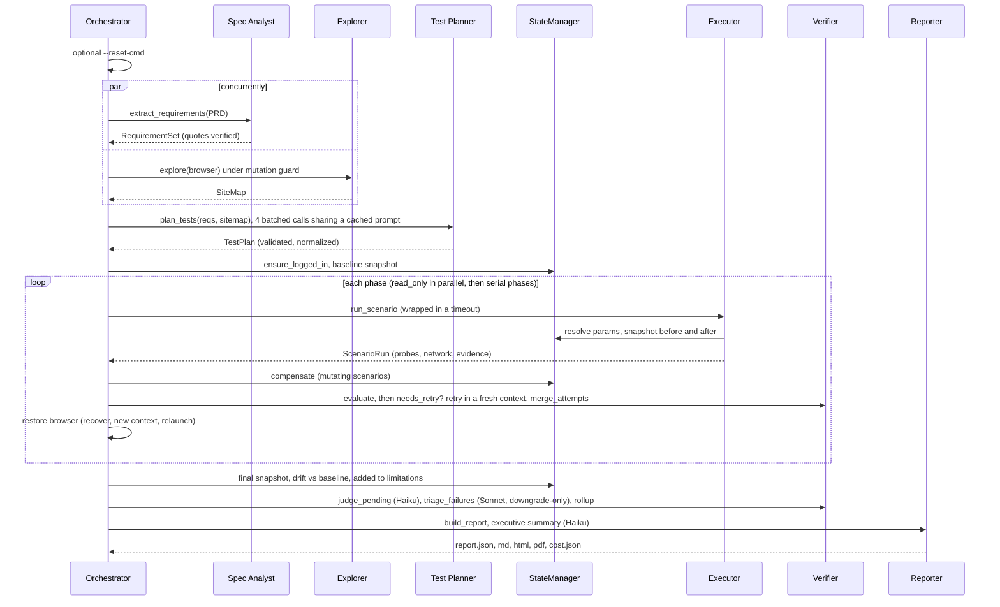

# Architecture

This document goes deeper than the [README](../README.md). It covers the data contracts passed between
agents, the oracle catalogue, the execution phases, the sequence of a run, and a file map. The binding
cross-agent rules are frozen in [`qa_agent/contracts/CONVENTIONS.md`](../qa_agent/contracts/CONVENTIONS.md).

## Design principles

1. **Black-box and generic.** The agent knows only the PRD and the URL. Element locators, endpoints,
   accounts, transaction types, statuses, the date span and the timezone are discovered at runtime.
   No target-specific value appears in `qa_agent/`, and `tests/test_no_eval_leak.py` enforces this.
2. **Facts first, judgment second.** The Executor records facts and the Verifier judges them with pure
   functions. LLMs plan the tests and look again at the results. They never create a pass or a failure.
3. **Unverified over wrong.** When a fact cannot be established, the oracle status is `error` and the
   scenario is `unverified`, never `failed`. A false defect report costs more than a miss.
4. **Shared data is sacred.** Every mutation is tagged, measured as a delta, and reversed.

## Data contracts

All contracts are Pydantic models in [`qa_agent/contracts/`](../qa_agent/contracts/), with
`extra="forbid"`. Every stage writes its output to `runs/<run_id>/artifacts/`, so each stage can be rerun
or inspected on its own.

| Contract | Producer → consumer | Key fields | File |
|---|---|---|---|
| `RequirementSet` / `Requirement` | Spec Analyst → Planner, Verifier, Reporter | `id` (`REQ-<AREA>-nnn`), `area`, `statement`, verbatim `source_quote`, `kind`, `priority` P0-P2, `testability` (automatable, partially, manual_only), `verification_hints` | `requirements.py` |
| `SiteMap` / `PageModel` / `ElementRef` / `ApiEndpoint` | Explorer → Planner, Executor, Verifier | `pages[route].elements[key]` (test_id, role+name, label, css, `healed_from`), `api[]`, `auth` (entry, logout, protected routes), `entities` (accounts, endpoints, tx types and statuses, date span, timezone, currency) | `sitemap.py` |
| `TestPlan` / `Scenario` / `Step` / `Oracle` / `ParamBinding` / `Target` | Planner → Executor, Verifier | `polarity` (positive, negative, edge), `phase`, `mutates_state`, `preconditions`, `params` (runtime bindings), `steps` (14 actions), `oracles` (22 types), `expected_money_delta`, `max_attempts` | `scenarios.py` |
| `ScenarioRun` / `StepResult` / `NetworkEvent` / `Evidence` | Executor → Verifier, Reporter | `resolved_params`, `steps`, `network` (redacted), `state_before` and `state_after`, `observations["probes"][i]`, `foreign_activity`, `aborted_reason`, evidence (screenshot, network, dom, aria, trace) | `execution.py` |
| `Snapshot` / `LedgerEntry` / `Compensation` | StateManager → Verifier, Reporter | balances (Decimal strings), tx ids; ledger `intended` flag and `memo_tag`; compensation `ok` | `state.py` |
| `OracleResult` / `ScenarioVerdict` / `RequirementVerdict` | Verifier → Reporter | `status` (pass, fail, error, skipped) per oracle with `expected`, `observed` and `layer` (ui, api, both); scenario `status`, `confidence`, `attempts`, `flaky`, `repro_steps`; requirement `status`, `reason`, `severity` | `verdicts.py` |
| `CostReport` / `LlmCall` | `CostTracker` → Reporter | per call: agent, model, purpose, tokens, cache read and write, usd, `cached_artifact_hit`; `by_agent` and `by_model` with `cold_usd`; `degraded` | `cost.py` |
| `AuditReport` | Reporter → `report.json` | summary, requirements, scenarios, defects, state_ledger, compensations, cost, environment, limitations | `report.py` |

## Scenario DSL

- **Targets** are semantic SiteMap keys (`transfer.amount`, `history.row[2]`, `nav.transactions~History`),
  never selectors.
- **Parameters** are resolved from a live snapshot just before the steps run (CONVENTIONS §3). The
  sources are `account` (select by `type=`, `index=` or `not=<param>`), `balance` (`of` an account,
  `plus` a signed decimal), `transaction` (pick earliest, latest or any, `where` type, status or account),
  `date` (offset from another param), `literal` and `derived`. Two built-ins are always available:
  `run_tag` and `unique_amount`. An unresolvable binding makes the scenario unverified.
- **Actions:** `goto`, `click`, `fill`, `select`, `submit`, `reload`, `back`, `logout`, `enter_demo`,
  `set_viewport`, `wait_for`, `snapshot_state`, `api_get`, `api_post`.
- **What the planner derives so the LLM does not write it:** `phase`, `mutates_state`,
  `expected_money_delta`, the `snapshot_state` steps, default preconditions, rationale, and oracle
  severity from priority. It also adds an API cross-check (`add_api_cross_check`). Scenarios that
  reference unknown keys, requirements, oracle types or params are dropped before execution.

## Oracle catalogue

Each oracle has one probe in [`dsl/probes.py`](../qa_agent/dsl/probes.py), which records raw facts, and
one pure judge in [`dsl/oracles.py`](../qa_agent/dsl/oracles.py). If a probe fails, the oracle is `error`
and the scenario is unverified.

| Oracle | Args | Passes when |
|---|---|---|
| `url_matches` | `pattern` | regex matches path+query |
| `element_visible` / `element_absent` | `target` | visible / not visible |
| `text_matches` / `text_not_matches` | `pattern`, `target?`, `ignore_case?` | target (or `main`) text matches / does not match |
| `money_format` | `target`, `pattern?` | every text contains a 2-decimal currency amount |
| `masked_identifier` | `{}` | no full account id or number from the API appears in visible text |
| `balance_delta` | `deltas: {acct: signed decimal}` | after − before equals expected, per account (Decimal) |
| `no_state_change` | `{}` | balances equal and no new tx ids (ignoring foreign activity) |
| `new_tx_count` | `n` | exactly `n` new tx ids |
| `tx_present_in_histories` | `accounts` | the scenario's new transaction appears in each account's history |
| `rows_satisfy_filters` | `filters` | every displayed row, looked up by id in the unfiltered API list, satisfies every filter (inclusive dates in the UI's timezone) |
| `rows_equal_api_set` | `filters` | the set of displayed ids equals the set computed from the API by applying the filters |
| `row_count_equals` | `n` | row count equals `n` |
| `empty_state_shown` | `{}` | 0 rows, a status message, no error alert |
| `ui_matches_api` | `{}` | displayed balance equals API balance per account |
| `api_status` | `method`, `path_glob`, `status` / `status_in` | some matching response has that status |
| `api_error_code_present` | `method?`, `path_glob` | a matching response carries a structured error object |
| `no_success_ui` | `{}` | no alert or status claims success or completion |
| `button_disabled_during` | `target`, `request_glob`, `delay_ms?` | while a delayed request is pending, the button is disabled or busy, and a double click sends at most one request |
| `no_horizontal_overflow` | `widths` | `scrollWidth <= clientWidth + 1` at each width |
| `llm_judge` | `question`, `inputs` | Haiku verdict is pass with confidence ≥ 0.7; anything else is unverified |

## Phases

| Phase | What runs | Concurrency | State handling |
|---|---|---|---|
| `read_only` | navigation, display, filters, masking, layout | up to `--parallel` forked contexts for parallel-safe scenarios (no logout, enter_demo or api_post steps, no `button_disabled_during`) | none needed |
| `negative_mutation` | invalid submissions that must be rejected | serial | snapshots before and after; `no_state_change`; compensation if money moved anyway |
| `positive_mutation` | valid transfers, boundaries, double submit | serial | snapshots; `balance_delta`; compensation reverses the intended movement |
| `session_destructive` | logout and protected-route checks | serial, last | session re-entered by recovery afterwards |

`--read-only` drops every scenario with `mutates_state`. `--only` filters by requirement-id globs.

## Sequence of a run



### Requirement roll-up rules

- **failed:** at least one linked scenario failed, and triage did not attribute the failure to a
  different requirement of a multi-requirement scenario. Severity comes from triage or from priority.
- **passed:** all linked scenarios passed, and at least one gives direct evidence. That means a positive
  scenario; or, for `validation`, `negative_scope` and `security` requirements, any passing scenario;
  or, for edge-only requirements, a passing edge scenario.
- **unverified:** everything else. This includes `manual_only` requirements and requirements with no
  planned scenario. The reason is stated.

### Retries and flakes

`needs_retry` fires when a scenario does not pass and the evidence suggests the environment, not the
product:
- a transient abort;
- foreign activity;
- a step error;
- a failure on a healed locator;
- a 5xx response or a failed mutation request;
- a transient probe error;
- an injected chaos fault.

A retry runs in a fresh browser context from the same start URL. `merge_attempts` handles the outcome:
- If a pass and a failure disagree, the scenario is unverified and flagged `flaky`.
- If every attempt fails, the failure stands, with slightly higher confidence.

## LLM layer

[`llm/client.py`](../qa_agent/llm/client.py) is the only module that calls the API. It handles:
- structured output into Pydantic models;
- prompt caching;
- a server-side refusal fallback on Sonnet calls;
- the content-addressed **artifact cache** ([`cache/artifacts.py`](../qa_agent/cache/artifacts.py)),
  keyed on prompt version plus inputs, with each entry's original cost stored in a sidecar;
- **budget enforcement** ([`llm/cost.py`](../qa_agent/llm/cost.py)). At 80% of the budget, calls marked
  `optional` are refused. At 100%, all calls are refused.

Prompts live in `llm/prompts/*.md`. Tests swap in `FakeLLM` and use no tokens.

## File map

```text
agent/
├── qa_agent/
│   ├── cli.py                 # typer CLI: run, extract, explore, plan, report, cost
│   ├── config.py              # RunConfig, model tiers, pricing
│   ├── orchestrator.py        # pipeline, phases, parallel workers, retries, recovery, chaos downgrade
│   ├── contracts/             # frozen Pydantic data contracts + CONVENTIONS.md
│   ├── agents/
│   │   ├── spec_analyst.py    # PRD -> RequirementSet (quote verification, id repair)
│   │   ├── explorer.py        # crawl -> SiteMap (DOM + a11y + network, Haiku labels)
│   │   ├── test_planner.py    # batched planning, draft -> Scenario conversion, validation
│   │   ├── executor.py        # run one scenario: params, steps, probes, evidence
│   │   ├── verifier.py        # evaluate, retry policy, merge, judge, triage, rollup
│   │   └── reporter.py        # defects, summary, coverage, md/html/pdf rendering
│   ├── browser/
│   │   ├── port.py            # BrowserPort protocol (Executor <-> browser)
│   │   ├── session.py         # Playwright implementation, network capture, mutation guard, fork
│   │   ├── waits.py           # settle(): network + aria-busy + loading text + DOM quiet
│   │   ├── locators.py        # test_id -> role -> label -> css -> guesses -> Haiku heal
│   │   ├── recovery.py        # re-enter session, retry error states, detect 404s
│   │   ├── chaos.py           # seeded latency / GET-only 503 injection
│   │   └── a11y.py            # compact ARIA snapshots for prompts and evidence
│   ├── dsl/
│   │   ├── actions.py         # step execution
│   │   ├── params.py          # ParamBinding resolution, tolerant API readers, Decimal money
│   │   ├── probes.py          # fact collection per oracle
│   │   └── oracles.py         # 22 deterministic judges
│   ├── state/
│   │   ├── snapshot.py        # StateManager: API snapshots, run tags, contexts
│   │   ├── ledger.py          # attribute new transactions, detect foreign activity and drift
│   │   └── compensator.py     # learn the transfer shape, reverse net movement, verify residuals
│   ├── llm/                   # client, cost tracker, prompts/
│   ├── cache/artifacts.py     # on-disk LLM artifact cache
│   ├── evidence/store.py      # evidence dirs, secret redaction
│   └── report_templates/      # report.md.j2, report.html.j2
├── eval/                      # score.py, multi_run.py, ground_truth.example.yaml
├── tests/                     # 207 offline tests (FakeLLM, local fixture servers)
├── docs/                      # ARCHITECTURE.md, COST.md
└── runs/sample/               # committed sample run with report, evidence, eval_score.json
```
