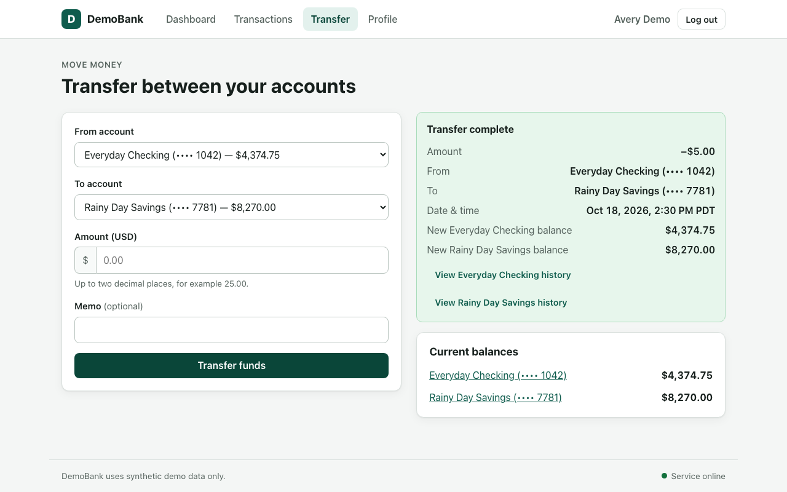
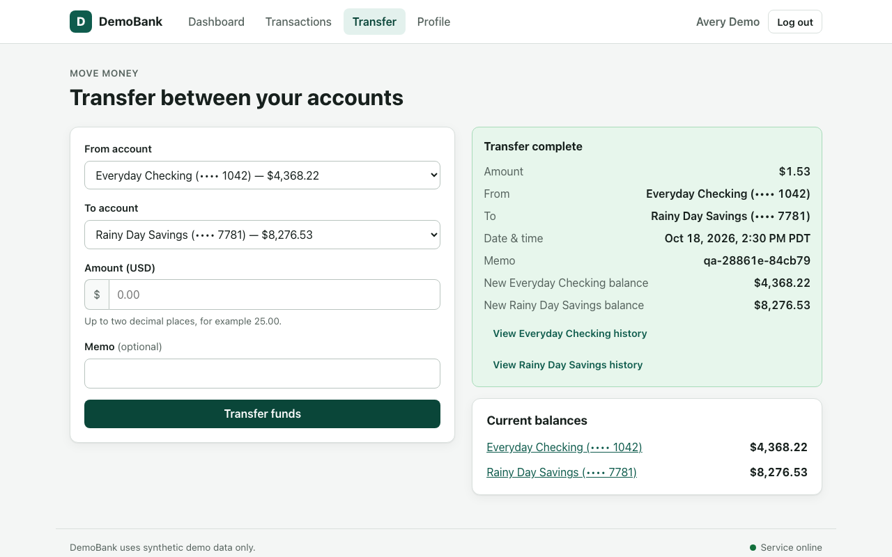
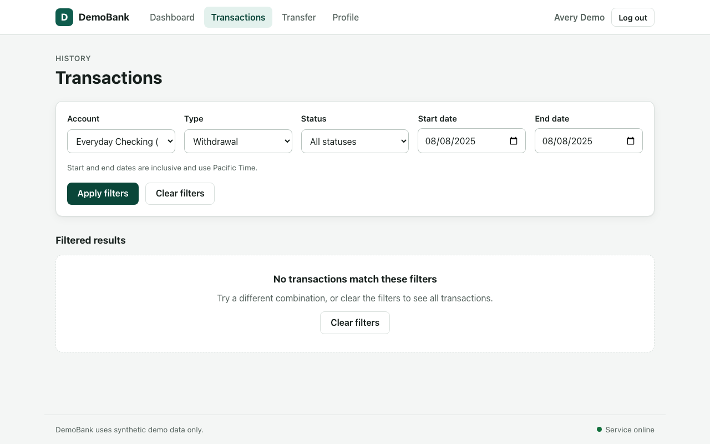
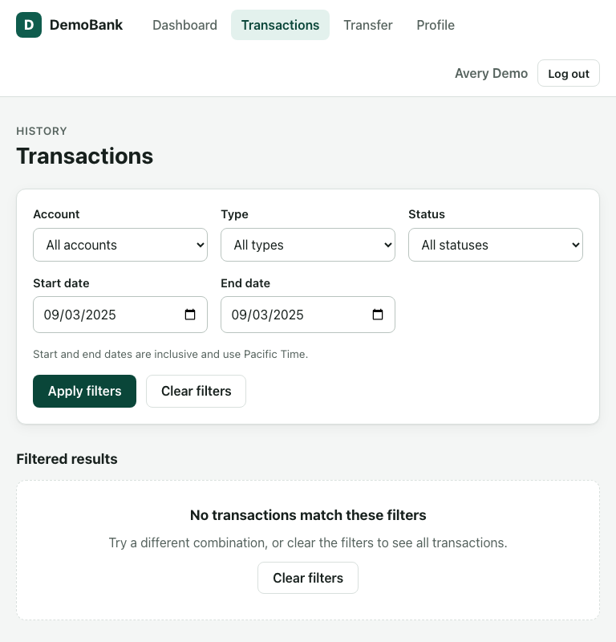
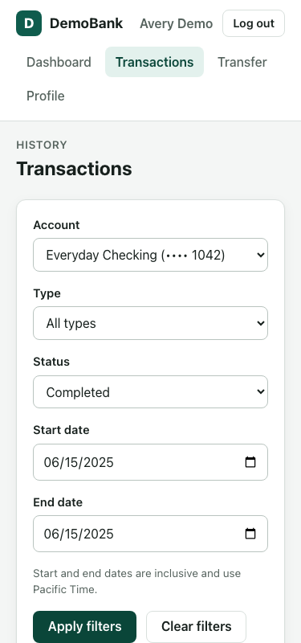

# QA Audit Report: http://localhost:5173

| | |
|---|---|
| Run | `qa-20261018-1628-861e` |
| Target | http://localhost:5173 |
| PRD sha256 | `5bf675015f276b04` |
| Started | 2026-10-18T21:28:38.723492+00:00 |
| Finished | 2026-10-18T21:31:54.642564+00:00 (196 s) |
| Generated | 2026-10-18T16:32:22-05:00 |

## Executive summary

The audit evaluated 49 requirements across the transfer and transaction history features, with 27 passing, 11 failing, and 11 unverified. Three critical defects were identified: the system accepts zero and negative transfer amounts and allows transfers that exceed available account balance, all while displaying success messages and creating completed transactions. Five major defects were also found, including incorrect handling of recoverable errors, missing amounts in transaction history rows, and date-range filtering that excludes boundary dates despite inclusive specification. The audit completed in 195.9 seconds at a cost of $0.10.

## Scorecard

| Status | Requirements |
|---|---:|
| passed | 27 |
| failed | 11 |
| unverified | 11 |
| **total** | **49** |

Pass rate on verified requirements: 71%. Verified (passed or failed): 78%.
Defects: 8 (3 critical, 5 major, 0 minor).
Estimated cost: $0.1008 ($0.0020 per requirement).

### By area

| Area | Passed | Failed | Unverified |
|---|---:|---:|---:|
| access | 5 | 0 | 1 |
| dashboard | 6 | 0 | 0 |
| history | 3 | 3 | 1 |
| profile | 2 | 0 | 0 |
| scope | 4 | 0 | 2 |
| seed | 2 | 1 | 0 |
| transfers | 1 | 6 | 7 |
| ui | 4 | 1 | 0 |

### Scenarios by polarity

| Polarity | Passed | Failed | Unverified |
|---|---:|---:|---:|
| positive | 22 | 2 | 2 |
| negative | 12 | 3 | 2 |
| edge | 12 | 4 | 0 |

## Coverage matrix

Each cell is the worst status among scenarios of that polarity ("-" = no scenario). A `*` marks a passed requirement whose covering scenario failed on a different requirement (that failure is reported there).

| Requirement | Area | Pri | Positive | Negative | Edge | Result | Defect |
|---|---|---|---|---|---|---|---|
| REQ-ACC-001 | access | P1 | unverified | - | - | **unverified** |  |
| REQ-ACC-002 | access | P1 | passed | - | - | **passed** |  |
| REQ-ACC-003 | access | P1 | passed | - | - | **passed** |  |
| REQ-ACC-004 | access | P0 | - | passed | passed | **passed** |  |
| REQ-ACC-005 | access | P1 | passed | - | - | **passed** |  |
| REQ-ACC-006 | access | P0 | - | passed | - | **passed** |  |
| REQ-DSH-001 | dashboard | P1 | passed | - | - | **passed** |  |
| REQ-DSH-002 | dashboard | P1 | passed | - | - | **passed** |  |
| REQ-DSH-003 | dashboard | P1 | passed | - | passed | **passed** |  |
| REQ-DSH-004 | dashboard | P0 | - | passed | - | **passed** |  |
| REQ-DSH-005 | dashboard | P1 | passed | - | passed | **passed** |  |
| REQ-DSH-006 | dashboard | P0 | passed | - | passed | **passed** |  |
| REQ-TRF-001 | transfers | P0 | unverified | - | - | **unverified** |  |
| REQ-TRF-002 | transfers | P1 | unverified | - | - | **unverified** |  |
| REQ-TRF-003 | transfers | P0 | - | passed | - | **passed** |  |
| REQ-TRF-004 | transfers | P0 | - | passed | - | **unverified** |  |
| REQ-TRF-005 | transfers | P0 | - | failed | passed | **failed** | DEF-001 |
| REQ-TRF-006 | transfers | P0 | - | failed | passed | **failed** | DEF-001 |
| REQ-TRF-007 | transfers | P0 | - | failed | passed | **failed** | DEF-002 |
| REQ-TRF-008 | transfers | P0 | - | failed | - | **failed** | DEF-002 |
| REQ-TRF-009 | transfers | P0 | unverified | - | passed | **unverified** |  |
| REQ-TRF-010 | transfers | P0 | unverified | - | - | **unverified** |  |
| REQ-TRF-011 | transfers | P1 | unverified | - | - | **unverified** |  |
| REQ-TRF-012 | transfers | P0 | unverified | failed | passed | **failed** | DEF-002 |
| REQ-TRF-013 | transfers | P0 | - | failed | - | **failed** | DEF-003 |
| REQ-TRF-014 | transfers | P0 | unverified | - | - | **unverified** |  |
| REQ-HIS-001 | history | P1 | passed | - | - | **passed**\* |  |
| REQ-HIS-002 | history | P1 | failed | - | - | **failed** | DEF-005 |
| REQ-HIS-003 | history | P2 | passed | - | - | **passed** |  |
| REQ-HIS-004 | history | P1 | passed | passed | failed | **failed** | DEF-006 |
| REQ-HIS-005 | history | P1 | - | - | failed | **failed** | DEF-007 |
| REQ-HIS-006 | history | P1 | - | passed | - | **unverified** |  |
| REQ-HIS-007 | history | P1 | passed | - | - | **passed** |  |
| REQ-PRO-001 | profile | P1 | passed | - | - | **passed** |  |
| REQ-PRO-002 | profile | P0 | passed | passed | - | **passed** |  |
| REQ-GUI-001 | ui | P2 | passed | - | passed | **passed** |  |
| REQ-GUI-002 | ui | P2 | passed | - | - | **passed** |  |
| REQ-GUI-003 | ui | P1 | - | - | passed | **passed** |  |
| REQ-GUI-004 | ui | P1 | passed | - | - | **passed** |  |
| REQ-GUI-005 | ui | P1 | - | passed | failed | **failed** | DEF-004 |
| REQ-SED-001 | seed | P1 | passed | - | passed | **passed** |  |
| REQ-SED-002 | seed | P1 | failed | - | passed | **failed** | DEF-008 |
| REQ-SED-003 | seed | P2 | passed | - | - | **passed** |  |
| REQ-SCP-001 | scope | P1 | - | unverified | - | **unverified** |  |
| REQ-SCP-002 | scope | P2 | - | passed | - | **passed** |  |
| REQ-SCP-003 | scope | P2 | - | passed | - | **passed** |  |
| REQ-SCP-004 | scope | P2 | - | passed | - | **passed** |  |
| REQ-SCP-005 | scope | P1 | - | unverified | - | **unverified** |  |
| REQ-SCP-006 | scope | P2 | - | passed | - | **passed** |  |

## Defects

| ID | Severity | Requirement(s) | Requirement not met | What the agent observed |
|---|---|---|---|---|
| [DEF-001](#def-001) | critical | REQ-TRF-005, REQ-TRF-006 | Blank, zero, negative, non-numeric and over-precision (more than two decimals) amounts are each rejected with a clear validation message. | POST /api/transfers with amount "0" returned 201 with a completed transaction e9a120d6-7b85-4798-8e61-8d065ec4f98c (amount 0.00), and the UI showed 'Transfer complete Amount $0.00'. |
| [DEF-002](#def-002) | critical | REQ-TRF-007, REQ-TRF-008, REQ-TRF-012 | A transfer exceeding the source account's available balance is rejected. | POST /api/transfers returned 201 with a completed transaction; Everyday Checking went from 4,369.75 to -0.01, Rainy Day Savings from 8,275.00 to 12,644.76, and the UI showed 'Transfer complete'. |
| [DEF-003](#def-003) | critical | REQ-TRF-013 | If a transfer is rejected or fails, the UI explains that it did not complete and does not show a success state. | POST /api/transfers with amount "0" returned 201 with a completed transaction e9a120d6-7b85-4798-8e61-8d065ec4f98c (amount 0.00), and the UI showed 'Transfer complete Amount $0.00'. |
| [DEF-004](#def-004) | major | REQ-GUI-005 | After a recoverable error the user can retry or return to the dashboard. | POST /api/transfers with amount 0 returned 201 and created a completed 0.00 transfer (75c1a987...), followed by the 1.53 transfer (c0339847...), giving 2 new transactions. |
| [DEF-005](#def-005) | major | REQ-HIS-002 | Each history row shows date and time, description or memo, transaction type, amount, status, and relevant account. | Four rows (ids ...209, ...210, ...211, ...212: pending/failed deposits and withdrawals) show 'No change: $0.00' instead of their amounts 400.00, 900.00, 125.00 and 700.00. |
| [DEF-006](#def-006) | major | REQ-HIS-004 | History can be filtered by account, transaction type, status and date range, and every displayed row satisfies all selected filters. | The filtered request /api/transactions?account_id=...101&type=withdrawal&start_date=2025-08-08&end_date=2025-08-08 returned an empty list and the UI showed 0 rows. |
| [DEF-007](#def-007) | major | REQ-HIS-005 | Start and end dates are inclusive: transactions on either boundary date that match other filters are included. | GET /api/transactions?start_date=2025-01-03&end_date=2025-01-03 returned an empty list and the UI showed 0 rows, although the completed deposit dated 2025-01-03 exists. |
| [DEF-008](#def-008) | major | REQ-SED-002 | Seed data includes enough historical transactions across multiple dates to exercise account, type, status and date filters. | The filtered request /api/transactions?account_id=...101&status=completed&start_date=2025-06-15&end_date=2025-06-15 returned an empty list and the UI showed 0 rows, while the unfiltered reference data contains that deposit. |

### DEF-001

**Requirement not met:** Blank, zero, negative, non-numeric and over-precision (more than two decimals) amounts are each rejected with a clear validation message.

- Severity: **critical** (requirement priority P0), confidence 0.95
- Requirement(s): REQ-TRF-005, REQ-TRF-006; scenario(s): SCN-TRF-005-N1, SCN-TRF-005-N2, SCN-TRF-005-N3, SCN-TRF-005-N4, SCN-TRF-005-E1
- Related defect(s) with the same failing scenarios: [DEF-003](#def-003)

> Blank, zero, negative, non-numeric, and over-precision values must be rejected with a clear validation message.

**Expected:**

- `SCN-TRF-005-N1`: A zero amount is rejected with a clear validation message, no transaction is created, and no success state is shown.
- `SCN-TRF-005-N2`: A negative amount (-5.00) is rejected with a validation message and creates no transaction and no balance change.

**Observed:**

- `SCN-TRF-005-N1`: POST /api/transfers with amount "0" returned 201 with a completed transaction e9a120d6-7b85-4798-8e61-8d065ec4f98c (amount 0.00), and the UI showed 'Transfer complete Amount $0.00'.
- `SCN-TRF-005-N2`: POST /api/transfers with -5.00 returned 201 with a completed transaction; Checking went 4,369.75 → 4,374.75, Savings 8,275.00 → 8,270.00, and the UI showed 'Transfer complete'.

**Steps to reproduce**

1. Precondition: logged in
2. Record balances and transactions before the action
3. Open the Transfer page: http://localhost:5173/transfer
4. Select checking as source (value: "Everyday Checking")
5. Select savings as destination (value: "Rainy Day Savings")
6. Enter 0 in the Amount field
7. Click Transfer funds
8. Record balances and transactions after the action

**Failed checks**

| Scenario | Check | Layer | Expected | Observed |
|---|---|---|---|---|
| SCN-TRF-005-N1 | no_state_change | api | no balance changes and no new transactions | 1 new transaction(s): e9a120d6-7b85-4798-8e61-8d065ec4f98c |
| SCN-TRF-005-N1 | no_success_ui | ui | no success confirmation is shown | success message shown: 'Transfer complete Transfer complete Amount $0.00 From Everyday Checking (•••• 1042) To Rainy Day Sa…' |
| SCN-TRF-005-N2 | no_state_change | api | no balance changes and no new transactions | Everyday Checking balance 4,369.75 → 4,374.75; Rainy Day Savings balance 8,275.00 → 8,270.00; 1 new transaction(s): caed842c-a7d0-4c86-96ac-d3369e6bd7ab |
| SCN-TRF-005-N2 | no_success_ui | ui | no success confirmation is shown | success message shown: 'Transfer complete Transfer complete Amount −$5.00 From Everyday Checking (•••• 1042) To Rainy Day S…' |

**Evidence**

-  [SCN-TRF-005-N1: final screen (attempt 1)](evidence/SCN-TRF-005-N1__a1__final.png)
- network: [SCN-TRF-005-N1: API calls recorded (attempt 1)](evidence/SCN-TRF-005-N1/a1_network.json)
-  [SCN-TRF-005-N2: final screen (attempt 1)](evidence/SCN-TRF-005-N2__a1__final.png)
- network: [SCN-TRF-005-N2: API calls recorded (attempt 1)](evidence/SCN-TRF-005-N2/a1_network.json)

### DEF-002

**Requirement not met:** A transfer exceeding the source account's available balance is rejected.

- Severity: **critical** (requirement priority P0), confidence 0.95
- Requirement(s): REQ-TRF-007, REQ-TRF-008, REQ-TRF-012; scenario(s): SCN-TRF-007-N1, SCN-TRF-007-E1, SCN-TRF-001-P1, SCN-TRF-012-E1, SCN-TRF-012-E2
- Related defect(s) with the same failing scenarios: [DEF-003](#def-003)

> The amount must not exceed the source account's available balance. If funds are insufficient, the transfer must be rejected

**Expected:** A transfer of 4369.76 from an account with an available balance of 4369.75 is rejected, balances stay unchanged, no completed transfer is recorded, and the UI explains the failure without showing success.

**Observed:** POST /api/transfers returned 201 with a completed transaction; Everyday Checking went from 4,369.75 to -0.01, Rainy Day Savings from 8,275.00 to 12,644.76, and the UI showed 'Transfer complete'.

**Steps to reproduce**

1. Precondition: logged in
2. Record balances and transactions before the action
3. Open the Transfer page: http://localhost:5173/transfer
4. Select checking as source (value: "Everyday Checking")
5. Select savings as destination (value: "Rainy Day Savings")
6. Enter an amount 0.01 above the checking balance (value: "4369.76")
7. Click Transfer funds
8. Record balances and transactions after the action

**Failed checks**

| Scenario | Check | Layer | Expected | Observed |
|---|---|---|---|---|
| SCN-TRF-007-N1 | no_state_change | api | no balance changes and no new transactions | Everyday Checking balance 4,369.75 → -0.01; Rainy Day Savings balance 8,275.00 → 12,644.76; 1 new transaction(s): 2b5f6f35-9e12-4a6b-b587-13d14391e267 |
| SCN-TRF-007-N1 | no_success_ui | ui | no success confirmation is shown | success message shown: 'Transfer complete Transfer complete Amount $4,369.76 From Everyday Checking (•••• 1042) To Rainy Da…' |
| SCN-TRF-007-N1 | llm_judge | ui | LLM judge: Does the message clearly say the transfer did not complete due to insufficient funds? | LLM judge said fail (confidence 0.98): The page shows 'Transfer complete' with successful transaction details, not a message indicating the transfer did not complete due to insufficient funds. |

**Evidence**

-  [SCN-TRF-007-N1: final screen (attempt 1)](evidence/SCN-TRF-007-N1__a1__final.png)
- network: [SCN-TRF-007-N1: API calls recorded (attempt 1)](evidence/SCN-TRF-007-N1/a1_network.json)

### DEF-003

**Requirement not met:** If a transfer is rejected or fails, the UI explains that it did not complete and does not show a success state.

- Severity: **critical** (requirement priority P0), confidence 0.95
- Requirement(s): REQ-TRF-013; scenario(s): SCN-TRF-003-N1, SCN-TRF-005-N1, SCN-TRF-007-N1
- Related defect(s) with the same failing scenarios: [DEF-001](#def-001), [DEF-002](#def-002)

> If a transfer is rejected or fails, the UI must explain that it did not complete and must not show a success state.

**Expected:**

- `SCN-TRF-005-N1`: A zero amount is rejected with a clear validation message, no transaction is created, and no success state is shown.
- `SCN-TRF-007-N1`: A transfer of 4369.76 from an account with an available balance of 4369.75 is rejected, balances stay unchanged, no completed transfer is recorded, and the UI explains the failure without showing success.

**Observed:**

- `SCN-TRF-005-N1`: POST /api/transfers with amount "0" returned 201 with a completed transaction e9a120d6-7b85-4798-8e61-8d065ec4f98c (amount 0.00), and the UI showed 'Transfer complete Amount $0.00'.
- `SCN-TRF-007-N1`: POST /api/transfers returned 201 with a completed transaction; Everyday Checking went from 4,369.75 to -0.01, Rainy Day Savings from 8,275.00 to 12,644.76, and the UI showed 'Transfer complete'.

**Steps to reproduce**

1. Precondition: logged in
2. Record balances and transactions before the action
3. Open the Transfer page: http://localhost:5173/transfer
4. Select checking as source (value: "Everyday Checking")
5. Select savings as destination (value: "Rainy Day Savings")
6. Enter 0 in the Amount field
7. Click Transfer funds
8. Record balances and transactions after the action

**Failed checks**

| Scenario | Check | Layer | Expected | Observed |
|---|---|---|---|---|
| SCN-TRF-005-N1 | no_state_change | api | no balance changes and no new transactions | 1 new transaction(s): e9a120d6-7b85-4798-8e61-8d065ec4f98c |
| SCN-TRF-005-N1 | no_success_ui | ui | no success confirmation is shown | success message shown: 'Transfer complete Transfer complete Amount $0.00 From Everyday Checking (•••• 1042) To Rainy Day Sa…' |
| SCN-TRF-007-N1 | no_state_change | api | no balance changes and no new transactions | Everyday Checking balance 4,369.75 → -0.01; Rainy Day Savings balance 8,275.00 → 12,644.76; 1 new transaction(s): 2b5f6f35-9e12-4a6b-b587-13d14391e267 |
| SCN-TRF-007-N1 | no_success_ui | ui | no success confirmation is shown | success message shown: 'Transfer complete Transfer complete Amount $4,369.76 From Everyday Checking (•••• 1042) To Rainy Da…' |
| SCN-TRF-007-N1 | llm_judge | ui | LLM judge: Does the message clearly say the transfer did not complete due to insufficient funds? | LLM judge said fail (confidence 0.98): The page shows 'Transfer complete' with successful transaction details, not a message indicating the transfer did not complete due to insufficient funds. |

**Evidence**

-  [SCN-TRF-005-N1: final screen (attempt 1)](evidence/SCN-TRF-005-N1__a1__final.png)
- network: [SCN-TRF-005-N1: API calls recorded (attempt 1)](evidence/SCN-TRF-005-N1/a1_network.json)
-  [SCN-TRF-007-N1: final screen (attempt 1)](evidence/SCN-TRF-007-N1__a1__final.png)
- network: [SCN-TRF-007-N1: API calls recorded (attempt 1)](evidence/SCN-TRF-007-N1/a1_network.json)

### DEF-004

**Requirement not met:** After a recoverable error the user can retry or return to the dashboard.

- Severity: **major** (requirement priority P1), confidence 0.95
- Requirement(s): REQ-GUI-005; scenario(s): SCN-GUI-005-E1, SCN-GUI-005-N1

> A recoverable error must leave the user able to retry or return to the dashboard.

**Expected:** A zero-amount transfer should be rejected with a recoverable validation error, so that only the retried 1.53 transfer creates a transaction (exactly 1 new transaction).

**Observed:** POST /api/transfers with amount 0 returned 201 and created a completed 0.00 transfer (75c1a987...), followed by the 1.53 transfer (c0339847...), giving 2 new transactions.

**Steps to reproduce**

1. Precondition: logged in
2. Record balances and transactions before the action
3. Open the transfer page: http://localhost:5173/transfer
4. Select checking as source (value: "Everyday Checking")
5. Select savings as destination (value: "Rainy Day Savings")
6. Enter 0 in Amount
7. Click Transfer funds
8. Replace the amount with the unique amount (value: "1.53")
9. Enter memo with run tag (value: "qa-28861e-84cb79")
10. Click Transfer funds again
11. Record balances and transactions after the action

**Failed checks**

| Scenario | Check | Layer | Expected | Observed |
|---|---|---|---|---|
| SCN-GUI-005-E1 | new_tx_count | api | exactly 1 new transaction(s) | 2 new transaction(s): c0339847-b379-42b4-9649-11decae8f966, 75c1a987-ee11-463d-a08d-219db6c0b333 |

**Evidence**

-  [SCN-GUI-005-E1: final screen (attempt 1)](evidence/SCN-GUI-005-E1__a1__final.png)
- network: [SCN-GUI-005-E1: API calls recorded (attempt 1)](evidence/SCN-GUI-005-E1/a1_network.json)

### DEF-005

**Requirement not met:** Each history row shows date and time, description or memo, transaction type, amount, status, and relevant account.

- Severity: **major** (requirement priority P1), confidence 0.95
- Requirement(s): REQ-HIS-002; scenario(s): SCN-HIS-001-P1

> Each row shows date and time, description or memo, transaction type, amount, status, and relevant account.

**Expected:** Each history row shows the transaction's amount (e.g. $700.00 for the failed deposit), per the PRD rule that each row shows amount.

**Observed:** Four rows (ids ...209, ...210, ...211, ...212: pending/failed deposits and withdrawals) show 'No change: $0.00' instead of their amounts 400.00, 900.00, 125.00 and 700.00.

**Steps to reproduce**

1. Precondition: logged in
2. Click Transactions in the navigation

**Failed checks**

| Scenario | Check | Layer | Expected | Observed |
|---|---|---|---|---|
| SCN-HIS-001-P1 | rows_equal_api_set | both | 12 transaction(s) matching no filters (from the API, dates inclusive in America/Los_Angeles), each row showing its API amount | UI shows the right 12 transaction(s) but 4 row(s) do not show the transaction amount: row 00000000-0000-0000-0000-000000000212 (deposit, failed): shows 'No change: $0.00', but the record's own amount field is 700.00 \| row 00000000-0000-0000-0000-000000000211 (withdrawal, pending): shows 'No change: $0.00', but the record's own amount field is 125.00 \| row 00000000-0000-0000-0000-000000000210 (withdrawal, failed): shows 'No change: $0.00', but the record's own amount field is 900.00 \| row 00000000-0000-0000-0000-000000000209 (deposit, pending): shows 'No change: $0.00', but the record's own amount field is 400.00 |

**Evidence**

-  [SCN-HIS-001-P1: final screen (attempt 1)](evidence/SCN-HIS-001-P1__a1__final.png)
- network: [SCN-HIS-001-P1: API calls recorded (attempt 1)](evidence/SCN-HIS-001-P1/a1_network.json)

### DEF-006

**Requirement not met:** History can be filtered by account, transaction type, status and date range, and every displayed row satisfies all selected filters.

- Severity: **major** (requirement priority P1), confidence 0.95
- Requirement(s): REQ-HIS-004; scenario(s): SCN-HIS-004-P1, SCN-HIS-004-P2, SCN-HIS-004-P3, SCN-HIS-004-E1, SCN-HIS-004-N1

> The user can filter history by account, transaction type, status, and date range. When filters are applied, every displayed row must satisfy all selected filters.

**Expected:** Filtering by account 101, type withdrawal and start/end date 2025-08-08 should show withdrawal 000...211 (pending, 2025-08-08), which satisfies all selected filters.

**Observed:** The filtered request /api/transactions?account_id=...101&type=withdrawal&start_date=2025-08-08&end_date=2025-08-08 returned an empty list and the UI showed 0 rows.

**Steps to reproduce**

1. Precondition: logged in
2. Open the transactions page: http://localhost:5173/transactions
3. Select the checking account (value: "Everyday Checking")
4. Select the type of an existing transaction (value: "withdrawal")
5. Enter the date as start date (value: "2025-08-08")
6. Enter the same date as end date (value: "2025-08-08")
7. Click Apply filters

**Failed checks**

| Scenario | Check | Layer | Expected | Observed |
|---|---|---|---|---|
| SCN-HIS-004-E1 | rows_equal_api_set | both | 1 transaction(s) matching account=Everyday Checking, type=withdrawal, start_date=2025-08-08, end_date=2025-08-08 (from the API, dates inclusive in America/Los_Angeles) | UI shows 0 row(s); missing 1 expected: 00000000-0000-0000-0000-000000000211 (withdrawal, pending, 2025-08-08) |

**Evidence**

-  [SCN-HIS-004-E1: final screen (attempt 1)](evidence/SCN-HIS-004-E1__a1__final.png)
- network: [SCN-HIS-004-E1: API calls recorded (attempt 1)](evidence/SCN-HIS-004-E1/a1_network.json)

### DEF-007

**Requirement not met:** Start and end dates are inclusive: transactions on either boundary date that match other filters are included.

- Severity: **major** (requirement priority P1), confidence 0.95
- Requirement(s): REQ-HIS-005; scenario(s): SCN-HIS-005-E1, SCN-HIS-005-E2

> The start and end dates are inclusive. A transaction occurring on either boundary date must be included when it matches the other filters.

**Expected:**

- `SCN-HIS-005-E1`: Filtering with start_date and end_date both set to 2025-01-03 includes transactions occurring on that date, such as deposit 00000000-0000-0000-0000-000000000201.
- `SCN-HIS-005-E2`: With start and end date both 2025-09-03, the transaction dated 2025-09-03 (id ...212) should be returned because both bounds are inclusive.

**Observed:**

- `SCN-HIS-005-E1`: GET /api/transactions?start_date=2025-01-03&end_date=2025-01-03 returned an empty list and the UI showed 0 rows, although the completed deposit dated 2025-01-03 exists.
- `SCN-HIS-005-E2`: GET /api/transactions?start_date=2025-09-03&end_date=2025-09-03 returned an empty list and the UI showed 0 rows, although transaction ...212 (deposit, failed, 2025-09-03T14:50:00Z) exists.

**Steps to reproduce**

1. Precondition: logged in
2. Open the transactions page: http://localhost:5173/transactions
3. Enter the earliest record date as start date (value: "2025-01-03")
4. Enter the same date as end date (value: "2025-01-03")
5. Click Apply filters

**Failed checks**

| Scenario | Check | Layer | Expected | Observed |
|---|---|---|---|---|
| SCN-HIS-005-E1 | rows_equal_api_set | both | 1 transaction(s) matching start_date=2025-01-03, end_date=2025-01-03 (from the API, dates inclusive in America/Los_Angeles) | UI shows 0 row(s); missing 1 expected: 00000000-0000-0000-0000-000000000201 (deposit, completed, 2025-01-03) |
| SCN-HIS-005-E2 | rows_equal_api_set | both | 1 transaction(s) matching start_date=2025-09-03, end_date=2025-09-03 (from the API, dates inclusive in America/Los_Angeles) | UI shows 0 row(s); missing 1 expected: 00000000-0000-0000-0000-000000000212 (deposit, failed, 2025-09-03) |

**Evidence**

-  [SCN-HIS-005-E1: final screen (attempt 1)](evidence/SCN-HIS-005-E1__a1__final.png)
- network: [SCN-HIS-005-E1: API calls recorded (attempt 1)](evidence/SCN-HIS-005-E1/a1_network.json)
-  [SCN-HIS-005-E2: final screen (attempt 1)](evidence/SCN-HIS-005-E2__a1__final.png)
- network: [SCN-HIS-005-E2: API calls recorded (attempt 1)](evidence/SCN-HIS-005-E2/a1_network.json)

### DEF-008

**Requirement not met:** Seed data includes enough historical transactions across multiple dates to exercise account, type, status and date filters.

- Severity: **major** (requirement priority P1), confidence 0.95
- Requirement(s): REQ-SED-002; scenario(s): SCN-SED-002-P1, SCN-SED-002-E1, SCN-SED-003-P1

> enough historical transactions to exercise account, type, status, and date filters. Seed records should include multiple dates

**Expected:** Filtering by checking account, status=completed and start=end=2025-06-15 (inclusive) should return the seeded completed deposit 00000000-0000-0000-0000-000000000208 dated 2025-06-15.

**Observed:** The filtered request /api/transactions?account_id=...101&status=completed&start_date=2025-06-15&end_date=2025-06-15 returned an empty list and the UI showed 0 rows, while the unfiltered reference data contains that deposit.

**Steps to reproduce**

1. Precondition: logged in
2. Open the transactions page: http://localhost:5173/transactions
3. Select the checking account in filter (value: "Everyday Checking")
4. Select Completed status (value: "completed")
5. Enter the start date (value: "2025-06-15")
6. Enter the same date as end date (value: "2025-06-15")
7. Click Apply filters

**Failed checks**

| Scenario | Check | Layer | Expected | Observed |
|---|---|---|---|---|
| SCN-SED-002-P1 | rows_equal_api_set | both | 1 transaction(s) matching account=Everyday Checking, status=completed, start_date=2025-06-15, end_date=2025-06-15 (from the API, dates inclusive in America/Los_Angeles) | UI shows 0 row(s); missing 1 expected: 00000000-0000-0000-0000-000000000208 (deposit, completed, 2025-06-15) |

**Evidence**

-  [SCN-SED-002-P1: final screen (attempt 1)](evidence/SCN-SED-002-P1__a1__final.png)
- network: [SCN-SED-002-P1: API calls recorded (attempt 1)](evidence/SCN-SED-002-P1/a1_network.json)

## Unverified requirements

An unverified requirement is neither a pass nor a defect: the agent could not collect conclusive evidence and says so instead of guessing.

| Requirement | Statement | Why unverified | Scenarios run | Evidence |
|---|---|---|---|---|
| REQ-ACC-001 | The landing page shows a clearly labeled Enter Demo action that opens the demo dashboard without requiring a password or real identity information. | The agent could not find the UI element 'landing.entry' (role=button[name="Enter Demo"]) on the page, so the check was inconclusive rather than failed. The screenshot shows the page at that moment; a human should confirm whether the control is missing (a defect) or just labelled differently. Technical reason: SCN-ACC-001-P1: element_visible could not verify: probe failed: ResolveError: could not resolve element 'landing.entry' (role=button[name="Enter Demo"]) | SCN-ACC-001-P1 (positive): unverified | [screenshot](evidence/SCN-ACC-001-P1__a1__final.png), [network](evidence/SCN-ACC-001-P1/a1_network.json) |
| REQ-TRF-001 | The user can transfer funds between the checking and savings accounts of the demo customer. | The checks were inconclusive; see the technical reason. Technical reason: SCN-TRF-001-P1: triage: not confirmed; The API oracles all pass: balances moved by exactly -1.54/+1.54, one completed transaction was created and appears in both histories, and the POST returned 201 with status completed. The only FAIL is a text_matches check on 'transactions.main', which captured the transfer page | SCN-TRF-001-P1 (positive): unverified SCN-TRF-001-P2 (positive): passed | [screenshot](evidence/SCN-TRF-001-P1__a1__final.png), [network](evidence/SCN-TRF-001-P1/a1_network.json), [network](evidence/SCN-TRF-001-P2/a1_network.json) |
| REQ-TRF-002 | The transfer form includes source account, destination account, amount, and an optional memo. | The checks were inconclusive; see the technical reason. Technical reason: SCN-TRF-001-P1: triage: not confirmed; The API oracles all pass: balances moved by exactly -1.54/+1.54, one completed transaction was created and appears in both histories, and the POST returned 201 with status completed. The only FAIL is a text_matches check on 'transactions.main', which captured the transfer page | SCN-TRF-001-P1 (positive): unverified SCN-TRF-002-P1 (positive): passed | [screenshot](evidence/SCN-TRF-001-P1__a1__final.png), [network](evidence/SCN-TRF-001-P1/a1_network.json), [network](evidence/SCN-TRF-002-P1/a1_network.json) |
| REQ-TRF-004 | A rejected same-account transfer does not alter balances or create a transaction. | Every covering scenario passed, but they only exercised rejection or edge paths; none directly demonstrated the behaviour this requirement asserts, so the agent does not claim a pass. Technical reason: no positive scenario verified the requirement | SCN-TRF-003-N1 (negative): passed | [screenshot](evidence/SCN-TRF-003-N1__a1__final.png), [network](evidence/SCN-TRF-003-N1/a1_network.json) |
| REQ-TRF-009 | A valid transfer is atomic: the source decreases by the amount and the destination increases by exactly the same amount. | The checks were inconclusive; see the technical reason. Technical reason: SCN-TRF-001-P1: triage: not confirmed; The API oracles all pass: balances moved by exactly -1.54/+1.54, one completed transaction was created and appears in both histories, and the POST returned 201 with status completed. The only FAIL is a text_matches check on 'transactions.main', which captured the transfer page | SCN-TRF-001-P1 (positive): unverified SCN-TRF-001-P2 (positive): passed SCN-TRF-007-E1 (edge): passed SCN-TRF-012-E1 (edge): passed | [screenshot](evidence/SCN-TRF-001-P1__a1__final.png), [network](evidence/SCN-TRF-001-P1/a1_network.json), [network](evidence/SCN-TRF-001-P2/a1_network.json), [network](evidence/SCN-TRF-007-E1/a1_network.json), [network](evidence/SCN-TRF-012-E1/a1_network.json) |
| REQ-TRF-010 | A successful transfer creates exactly one completed transfer record that appears in both the source and destination account histories. | The checks were inconclusive; see the technical reason. Technical reason: SCN-TRF-001-P1: triage: not confirmed; The API oracles all pass: balances moved by exactly -1.54/+1.54, one completed transaction was created and appears in both histories, and the POST returned 201 with status completed. The only FAIL is a text_matches check on 'transactions.main', which captured the transfer page | SCN-TRF-001-P1 (positive): unverified SCN-TRF-001-P2 (positive): passed | [screenshot](evidence/SCN-TRF-001-P1__a1__final.png), [network](evidence/SCN-TRF-001-P1/a1_network.json), [network](evidence/SCN-TRF-001-P2/a1_network.json) |
| REQ-TRF-011 | The transfer record shows amount, date and time, source, destination, status, and memo if supplied. | The checks were inconclusive; see the technical reason. Technical reason: SCN-TRF-001-P1: triage: not confirmed; The API oracles all pass: balances moved by exactly -1.54/+1.54, one completed transaction was created and appears in both histories, and the POST returned 201 with status completed. The only FAIL is a text_matches check on 'transactions.main', which captured the transfer page | SCN-TRF-001-P1 (positive): unverified SCN-TRF-001-P2 (positive): passed | [screenshot](evidence/SCN-TRF-001-P1__a1__final.png), [network](evidence/SCN-TRF-001-P1/a1_network.json), [network](evidence/SCN-TRF-001-P2/a1_network.json) |
| REQ-TRF-014 | After a successful transfer and a page refresh, the updated balances and the transaction record persist. | The checks were inconclusive; see the technical reason. Technical reason: SCN-TRF-001-P1: triage: not confirmed; The API oracles all pass: balances moved by exactly -1.54/+1.54, one completed transaction was created and appears in both histories, and the POST returned 201 with status completed. The only FAIL is a text_matches check on 'transactions.main', which captured the transfer page | SCN-TRF-001-P1 (positive): unverified | [screenshot](evidence/SCN-TRF-001-P1__a1__final.png), [network](evidence/SCN-TRF-001-P1/a1_network.json) |
| REQ-HIS-006 | An empty filter result shows a clear empty state, not an error or unrelated transactions. | Every covering scenario passed, but they only exercised rejection or edge paths; none directly demonstrated the behaviour this requirement asserts, so the agent does not claim a pass. Technical reason: no positive scenario verified the requirement | SCN-HIS-006-N1 (negative): passed | [screenshot](evidence/SCN-HIS-006-N1__a1__final.png), [network](evidence/SCN-HIS-006-N1/a1_network.json) |
| REQ-SCP-001 | The app never initiates real payments or connects to an external bank. | An LLM judgement check could not reach a confident verdict, so the agent did not guess. Technical reason: SCN-SCP-001-N1: triage: not confirmed; The deterministic text oracle passed, finding no external bank or payment terms on the transfer page. The llm_judge 'fail' is a mis-specified result: its own explanation says the page only offers transfers between internal accounts and has no controls for external payments, ba | SCN-SCP-001-N1 (negative): unverified | [screenshot](evidence/SCN-SCP-001-N1__a1__final.png), [network](evidence/SCN-SCP-001-N1/a1_network.json) |
| REQ-SCP-005 | The app offers no real bank integrations or deposits from external sources. | An LLM judgement check could not reach a confident verdict, so the agent did not guess. Technical reason: SCN-SCP-001-N1: triage: not confirmed; The deterministic text oracle passed, finding no external bank or payment terms on the transfer page. The llm_judge 'fail' is a mis-specified result: its own explanation says the page only offers transfers between internal accounts and has no controls for external payments, ba | SCN-SCP-003-N1 (negative): passed SCN-SCP-001-N1 (negative): unverified | [screenshot](evidence/SCN-SCP-003-N1__a1__final.png), [network](evidence/SCN-SCP-003-N1/a1_network.json), [network](evidence/SCN-SCP-001-N1/a1_network.json) |

## All requirement results

| Requirement | Status | Statement | Reason |
|---|---|---|---|
| REQ-ACC-001 | unverified | The landing page shows a clearly labeled Enter Demo action that opens the demo dashboard without requiring a password or real identity information. | SCN-ACC-001-P1: element_visible could not verify: probe failed: ResolveError: could not resolve element 'landing.entry' (role=button[name="Enter Demo"]) |
| REQ-ACC-002 | passed | The header identifies the active demo customer and provides a Log out action. | all 1 scenario(s) passed: SCN-ACC-002-P1 |
| REQ-ACC-003 | passed | Logging out returns the user to the landing page. | all 1 scenario(s) passed: SCN-ACC-003-P1 |
| REQ-ACC-004 | passed | After logout, direct navigation to protected dashboard views returns the user to the landing page or an access-required state and does not show protected content. | all 3 scenario(s) passed: SCN-ACC-004-N1, SCN-ACC-004-N2, SCN-ACC-004-E1 |
| REQ-ACC-005 | passed | Refreshing a page during a valid demo session preserves the session. | all 1 scenario(s) passed: SCN-ACC-005-P1 |
| REQ-ACC-006 | passed | A logged-out user does not regain access to a protected page by refreshing it. | all 1 scenario(s) passed: SCN-ACC-006-N1 |
| REQ-DSH-001 | passed | The dashboard shows the customer's checking and savings accounts. | all 1 scenario(s) passed: SCN-DSH-001-P1 |
| REQ-DSH-002 | passed | Each account card displays a readable name, a masked account identifier, account type, and current available balance in USD. | all 1 scenario(s) passed: SCN-DSH-001-P1 |
| REQ-DSH-003 | passed | Balances are displayed with exactly two decimal places. | all 2 scenario(s) passed: SCN-DSH-003-E1, SCN-DSH-003-P1 |
| REQ-DSH-004 | passed | The UI never exposes a full account identifier. | all 1 scenario(s) passed: SCN-DSH-004-N1 |
| REQ-DSH-005 | passed | Selecting an account opens an account detail view showing its current balance and related transaction history. | all 2 scenario(s) passed: SCN-DSH-005-P1, SCN-DSH-005-E1 |
| REQ-DSH-006 | passed | Balances on the dashboard and account detail view agree with each other and with the latest successful transactions. | all 3 scenario(s) passed: SCN-DSH-003-P1, SCN-DSH-005-P1, SCN-DSH-005-E1 |
| REQ-TRF-001 | unverified | The user can transfer funds between the checking and savings accounts of the demo customer. | SCN-TRF-001-P1: triage: not confirmed; The API oracles all pass: balances moved by exactly -1.54/+1.54, one completed transaction was created and appears in both histories, and the POST returned 201 with status completed. The only FAIL is a text_matches check on 'transactions.main', which captured the transfer page |
| REQ-TRF-002 | unverified | The transfer form includes source account, destination account, amount, and an optional memo. | SCN-TRF-001-P1: triage: not confirmed; The API oracles all pass: balances moved by exactly -1.54/+1.54, one completed transaction was created and appears in both histories, and the POST returned 201 with status completed. The only FAIL is a text_matches check on 'transactions.main', which captured the transfer page |
| REQ-TRF-003 | passed | A transfer with the same source and destination account is rejected with a clear explanation. | all 1 scenario(s) passed: SCN-TRF-003-N1 |
| REQ-TRF-004 | unverified | A rejected same-account transfer does not alter balances or create a transaction. | no positive scenario verified the requirement |
| REQ-TRF-005 | failed | Blank, zero, negative, non-numeric and over-precision (more than two decimals) amounts are each rejected with a clear validation message. | SCN-TRF-005-N1 (negative) failed: no_state_change, no_success_ui; SCN-TRF-005-N2 (negative) failed: no_state_change, no_success_ui |
| REQ-TRF-006 | failed | Rejected invalid amount input does not create a transaction or change balances. | SCN-TRF-005-N1 (negative) failed: no_state_change, no_success_ui; SCN-TRF-005-N2 (negative) failed: no_state_change, no_success_ui |
| REQ-TRF-007 | failed | A transfer exceeding the source account's available balance is rejected. | SCN-TRF-007-N1 (negative) failed: no_state_change, no_success_ui, llm_judge |
| REQ-TRF-008 | failed | An insufficient-funds transfer leaves both balances unchanged and no completed transfer appears in history. | SCN-TRF-007-N1 (negative) failed: no_state_change, no_success_ui, llm_judge |
| REQ-TRF-009 | unverified | A valid transfer is atomic: the source decreases by the amount and the destination increases by exactly the same amount. | SCN-TRF-001-P1: triage: not confirmed; The API oracles all pass: balances moved by exactly -1.54/+1.54, one completed transaction was created and appears in both histories, and the POST returned 201 with status completed. The only FAIL is a text_matches check on 'transactions.main', which captured the transfer page |
| REQ-TRF-010 | unverified | A successful transfer creates exactly one completed transfer record that appears in both the source and destination account histories. | SCN-TRF-001-P1: triage: not confirmed; The API oracles all pass: balances moved by exactly -1.54/+1.54, one completed transaction was created and appears in both histories, and the POST returned 201 with status completed. The only FAIL is a text_matches check on 'transactions.main', which captured the transfer page |
| REQ-TRF-011 | unverified | The transfer record shows amount, date and time, source, destination, status, and memo if supplied. | SCN-TRF-001-P1: triage: not confirmed; The API oracles all pass: balances moved by exactly -1.54/+1.54, one completed transaction was created and appears in both histories, and the POST returned 201 with status completed. The only FAIL is a text_matches check on 'transactions.main', which captured the transfer page |
| REQ-TRF-012 | failed | The UI shows a success state only after the transfer has been committed. | SCN-TRF-007-N1 (negative) failed: no_state_change, no_success_ui, llm_judge |
| REQ-TRF-013 | failed | If a transfer is rejected or fails, the UI explains that it did not complete and does not show a success state. | SCN-TRF-005-N1 (negative) failed: no_state_change, no_success_ui; SCN-TRF-007-N1 (negative) failed: no_state_change, no_success_ui, llm_judge |
| REQ-TRF-014 | unverified | After a successful transfer and a page refresh, the updated balances and the transaction record persist. | SCN-TRF-001-P1: triage: not confirmed; The API oracles all pass: balances moved by exactly -1.54/+1.54, one completed transaction was created and appears in both histories, and the POST returned 201 with status completed. The only FAIL is a text_matches check on 'transactions.main', which captured the transfer page |
| REQ-HIS-001 | passed | The user can view a combined transaction history and an account-specific history. | all 1 scenario(s) passed: SCN-HIS-001-P2 (SCN-HIS-001-P1 failed on another requirement) |
| REQ-HIS-002 | failed | Each history row shows date and time, description or memo, transaction type, amount, status, and relevant account. | SCN-HIS-001-P1 (positive) failed: rows_equal_api_set |
| REQ-HIS-003 | passed | Amount direction is clear for deposits, withdrawals and transfers. | all 1 scenario(s) passed: SCN-HIS-003-P1 |
| REQ-HIS-004 | failed | History can be filtered by account, transaction type, status and date range, and every displayed row satisfies all selected filters. | SCN-HIS-004-E1 (edge) failed: rows_equal_api_set |
| REQ-HIS-005 | failed | Start and end dates are inclusive: transactions on either boundary date that match other filters are included. | SCN-HIS-005-E1 (edge) failed: rows_equal_api_set; SCN-HIS-005-E2 (edge) failed: rows_equal_api_set |
| REQ-HIS-006 | unverified | An empty filter result shows a clear empty state, not an error or unrelated transactions. | no positive scenario verified the requirement |
| REQ-HIS-007 | passed | Clearing filters restores the unfiltered history. | all 1 scenario(s) passed: SCN-HIS-007-P1 |
| REQ-PRO-001 | passed | The profile view displays only synthetic demo-customer details such as display name and a masked email address. | all 1 scenario(s) passed: SCN-PRO-001-P1 |
| REQ-PRO-002 | passed | The profile view does not reveal passwords, authentication tokens, full account identifiers, or another user's data. | all 2 scenario(s) passed: SCN-PRO-001-P1, SCN-PRO-002-N1 |
| REQ-GUI-001 | passed | The app works in a current desktop browser at 1280x800 and remains usable at narrower widths. | all 3 scenario(s) passed: SCN-GUI-001-P1, SCN-GUI-001-E1, SCN-GUI-001-E2 |
| REQ-GUI-002 | passed | Interactive controls have readable labels and communicate loading, success, validation and failure states. | all 1 scenario(s) passed: SCN-GUI-002-P1 |
| REQ-GUI-003 | passed | A submitted action does not silently disappear: the UI shows a loading state or prevents duplicate submission while waiting. | all 2 scenario(s) passed: SCN-GUI-003-E1, SCN-TRF-012-E2 |
| REQ-GUI-004 | passed | Navigation links and buttons lead to the labeled destination or perform the labeled action. | all 3 scenario(s) passed: SCN-GUI-004-P1, SCN-GUI-004-P2, SCN-GUI-004-P3 |
| REQ-GUI-005 | failed | After a recoverable error the user can retry or return to the dashboard. | SCN-GUI-005-E1 (edge) failed: new_tx_count |
| REQ-SED-001 | passed | The demo begins with one customer, one checking account and one savings account. | all 2 scenario(s) passed: SCN-SED-001-P1, SCN-SED-001-E1 |
| REQ-SED-002 | failed | Seed data includes enough historical transactions across multiple dates to exercise account, type, status and date filters. | SCN-SED-002-P1 (positive) failed: rows_equal_api_set |
| REQ-SED-003 | passed | Seed data includes at least one transfer between the checking and savings accounts. | all 1 scenario(s) passed: SCN-SED-003-P1 |
| REQ-SCP-001 | unverified | The app never initiates real payments or connects to an external bank. | SCN-SCP-001-N1: triage: not confirmed; The deterministic text oracle passed, finding no external bank or payment terms on the transfer page. The llm_judge 'fail' is a mis-specified result: its own explanation says the page only offers transfers between internal accounts and has no controls for external payments, ba |
| REQ-SCP-002 | passed | The app offers no signup feature. | all 2 scenario(s) passed: SCN-SCP-002-N1, SCN-SCP-003-N1 |
| REQ-SCP-003 | passed | The app offers no external payment, bill-pay, loan or card features. | all 1 scenario(s) passed: SCN-SCP-003-N1 |
| REQ-SCP-004 | passed | The app offers no multi-user features, joint accounts or multiple customers. | all 2 scenario(s) passed: SCN-SCP-002-N1, SCN-SCP-003-N1 |
| REQ-SCP-005 | unverified | The app offers no real bank integrations or deposits from external sources. | SCN-SCP-001-N1: triage: not confirmed; The deterministic text oracle passed, finding no external bank or payment terms on the transfer page. The llm_judge 'fail' is a mis-specified result: its own explanation says the page only offers transfers between internal accounts and has no controls for external payments, ba |
| REQ-SCP-006 | passed | The app offers no password reset, multi-factor authentication or production-grade identity verification. | all 2 scenario(s) passed: SCN-SCP-002-N1, SCN-SCP-003-N1 |

## State ledger and compensations

Every mutation the agent made is tagged and recorded; unintended ones (accepted by a bug) are reversed by a compensating transfer.

| Scenario | Tx | Deltas | Intended | Memo tag |
|---|---|---|---|---|
| SCN-TRF-005-N1 | e9a120d6-7b85-4798-8e61-8d065ec4f98c | Everyday Checking: 0.00; Rainy Day Savings: 0.00 | **NO** | qa-28861e-d498f3 |
| SCN-TRF-005-N2 | caed842c-a7d0-4c86-96ac-d3369e6bd7ab | Everyday Checking: 5.00; Rainy Day Savings: -5.00 | **NO** | qa-28861e-4e6ad3 |
| SCN-TRF-007-N1 | 2b5f6f35-9e12-4a6b-b587-13d14391e267 | Everyday Checking: -4369.76; Rainy Day Savings: 4369.76 | **NO** | qa-28861e-857326 |
| SCN-GUI-003-E1 | 3b4da4e2-2bb5-4099-a0aa-4287876198df | Everyday Checking: -1.52; Rainy Day Savings: 1.52 | yes | qa-28861e-937bd1 |
| SCN-GUI-005-E1 | c0339847-b379-42b4-9649-11decae8f966 | Everyday Checking: -1.53; Rainy Day Savings: 1.53 | yes | qa-28861e-84cb79 |
| SCN-GUI-005-E1 | 75c1a987-ee11-463d-a08d-219db6c0b333 | Everyday Checking: 0.00; Rainy Day Savings: 0.00 | yes | qa-28861e-84cb79 |
| SCN-TRF-001-P1 | 05491626-e5eb-40a4-b04e-14b538eb01ee | Everyday Checking: -1.54; Rainy Day Savings: 1.54 | yes | qa-28861e-8f124a |
| SCN-TRF-001-P2 | 1eb2dbf0-d0d4-4318-bd5d-4b1ea9f1d6e9 | Rainy Day Savings: -1.55; Everyday Checking: 1.55 | yes | qa-28861e-e4fd0b |
| SCN-TRF-007-E1 | b7d38a55-19fd-43e7-8feb-9735695a5ff6 | Everyday Checking: -4369.75; Rainy Day Savings: 4369.75 | yes | qa-28861e-97aa7e |
| SCN-TRF-012-E1 | fe6cb677-7a76-44ef-b2f2-dd721a24bedb | Rainy Day Savings: -0.01; Everyday Checking: 0.01 | yes | qa-28861e-ee7023 |
| SCN-TRF-012-E2 | 75971e69-b5d7-4f6a-bc3f-650a2f8994be | Everyday Checking: -1.58; Rainy Day Savings: 1.58 | yes | qa-28861e-237867 |

| Compensation reason | Tx | Deltas | OK |
|---|---|---|---|
| SCN-TRF-005-N2: reverse 5.00 from Everyday Checking to Rainy Day Savings | e84f1c62-fc2c-4295-8105-9446d4bfa9a6 | Everyday Checking: -5.00; Rainy Day Savings: 5.00 | yes |
| SCN-TRF-007-N1: reverse 4369.76 from Rainy Day Savings to Everyday Checking | f1ffc46d-1e7c-4abc-89e5-3fbaec7bb7fe | Rainy Day Savings: -4369.76; Everyday Checking: 4369.76 | yes |
| SCN-GUI-003-E1: reverse 1.52 from Rainy Day Savings to Everyday Checking | d310e0b5-d008-4236-849f-2a0bc28ad498 | Rainy Day Savings: -1.52; Everyday Checking: 1.52 | yes |
| SCN-GUI-005-E1: reverse 1.53 from Rainy Day Savings to Everyday Checking | 75d03833-c1b8-4906-b693-6a92f763a6c5 | Rainy Day Savings: -1.53; Everyday Checking: 1.53 | yes |
| SCN-TRF-001-P1: reverse 1.54 from Rainy Day Savings to Everyday Checking | 05fbb707-9f45-43a1-bef0-a4e1b2ca9632 | Rainy Day Savings: -1.54; Everyday Checking: 1.54 | yes |
| SCN-TRF-001-P2: reverse 1.55 from Everyday Checking to Rainy Day Savings | 06a1eae1-6ac2-43ea-935e-b1ea41752132 | Everyday Checking: -1.55; Rainy Day Savings: 1.55 | yes |
| SCN-TRF-007-E1: reverse 4369.75 from Rainy Day Savings to Everyday Checking | a962a354-e4c1-4842-a980-3e807ca9ac33 | Rainy Day Savings: -4369.75; Everyday Checking: 4369.75 | yes |
| SCN-TRF-012-E1: reverse 0.01 from Everyday Checking to Rainy Day Savings | fec35287-d6ae-42b0-bb41-729f035541d5 | Everyday Checking: -0.01; Rainy Day Savings: 0.01 | yes |
| SCN-TRF-012-E2: reverse 1.58 from Rainy Day Savings to Everyday Checking | 08d20399-906e-4a6d-8c28-9f0fc32d8051 | Rainy Day Savings: -1.58; Everyday Checking: 1.58 | yes |

## Cost

Total estimated model cost: **$0.1008** of a $1.5000 budget (6.7%).

### Per agent

| Agent | Model(s) | Calls | Input tok | Output tok | Cache read | Cache write | USD | Share | Artifact-cache hits |
|---|---|---:|---:|---:|---:|---:|---:|---:|---:|
| executor_heal | claude-haiku-4-5 | 20 | 4,267 | 92 | 0 | 0 | $0.0047 | 5% | 17 |
| explorer | claude-haiku-4-5 | 6 | 0 | 0 | 0 | 0 | $0.0000 | 0% | 6 |
| reporter | claude-haiku-4-5 | 1 | 1,801 | 127 | 0 | 0 | $0.0024 | 2% | 0 |
| spec_analyst | claude-sonnet-5-5 | 1 | 0 | 0 | 0 | 0 | $0.0000 | 0% | 1 |
| test_planner | claude-sonnet-5-5 | 4 | 0 | 0 | 0 | 0 | $0.0000 | 0% | 4 |
| verifier | claude-haiku-4-5, claude-sonnet-5-5 | 16 | 28,377 | 3,995 | 17,402 | 0 | $0.0936 | 93% | 0 |
| **total** | | **48** | **34,445** | **4,214** | **17,402** | **0** | **$0.1008** | **100%** | **28** |

### Per model

| Model | Calls | Input tok | Output tok | Cache read | Cache write | USD | Artifact-cache hits |
|---|---:|---:|---:|---:|---:|---:|---:|
| claude-haiku-4-5 | 32 | 10,778 | 593 | 0 | 0 | $0.0137 | 23 |
| claude-sonnet-5-5 | 16 | 23,667 | 3,621 | 17,402 | 0 | $0.0870 | 5 |

**Cold vs warm:** this was a warm run: 28 of 48 model calls were served from the on-disk artifact cache at no cost. A cold run (empty cache) is estimated at **$0.1830** (each cache hit priced at the average of live calls for the same agent and purpose).
Prompt-cache reads made up 34% of input tokens.

## Environment

| Key | Value |
|---|---|
| target_url | http://localhost:5173 |
| api_base | http://localhost:8000 |
| timezone | America/Los_Angeles |
| models | reasoning: claude-sonnet-5-5, fast: claude-haiku-4-5 |
| python | 3.13.9 |
| platform | macOS-26.6.2-arm64-arm-64bit-Mach-O |
| read_only | no |
| chaos | off |
| parallel | 3 |
| scenario_timeout_s | 90.0 |

## Resilience

Chaos mode was off for this run.
35 read-only scenarios ran in 3 parallel browser contexts.

| After scenario | What the agent saw and did |
|---|---|
| SCN-HIS-004-N1 | page left in an error state ("We couldn't load transactions Start date must not be after end date. Try again") → recovery: error state ("We couldn't load transactions Start date must not be after end date. Try again Back to dashboard"); clicked retry once → error state persisted; opened a new browser context |

## Limitations

- The agent repaired the browser state 1 time(s) between scenarios (see environment.resilience).
